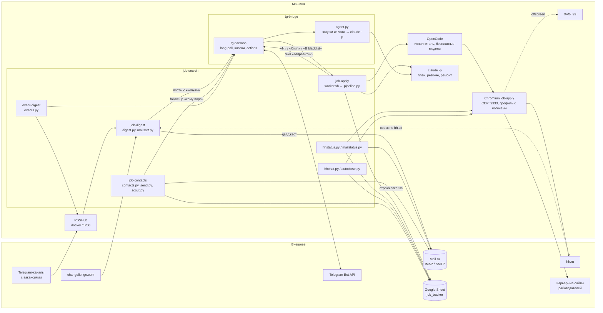
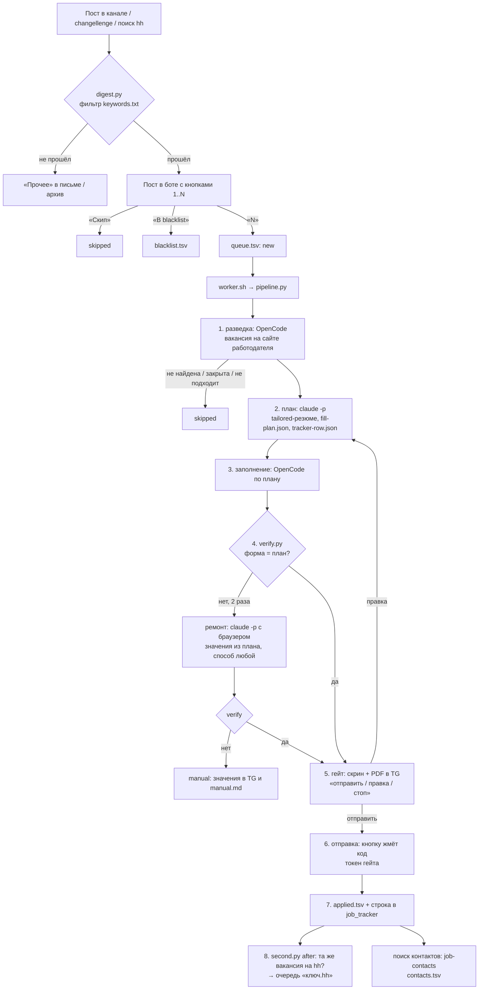
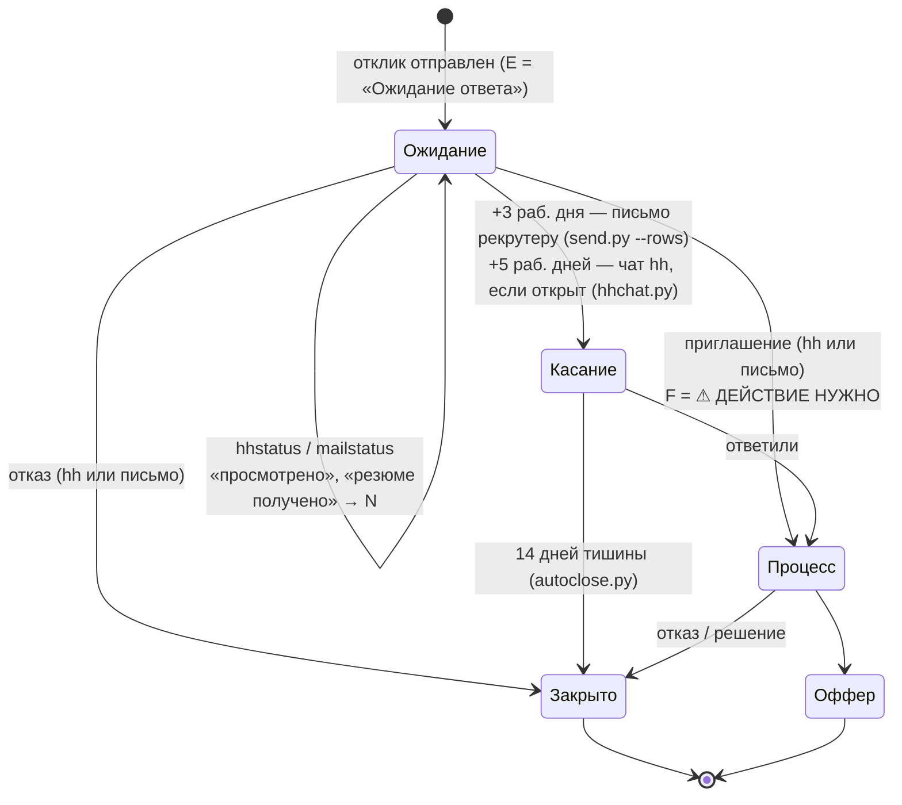
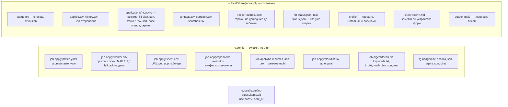

# Как это устроено: job-search + tg-bridge на одной машине

Документ про то, как плагины `job-search` и `tg-bridge` живут на машине: что запускается само, где лежит
состояние, кто кого вызывает и где оно обычно ломается. Что делает каждый скилл, написано в его `SKILL.md`.
Здесь только связи между ними.

Коротко:

- **Код** лежит в этом репо. Таймеры и бот запускают скрипты прямо из клона (`~/playground/sapar-skills`), а не
  из кэша плагинов Claude Code.
- **Конфиги и секреты** лежат в `~/.config/{job-apply,job-digest,job-contacts,tg-bridge}`, в репо их нет.
- **Состояние** лежит в `~/.local/share/job-apply` (очередь, отклики, контакты, папки откликов) и в
  `~/.local/state/job-digest` (база постов).
- **Источник правды по откликам** — Google-таблица `job_tracker`, лист Applications. Скрипты пишут в неё через
  Apps Script web app (`sheet.py`).
- **Человек в цикле** — Telegram-бот (`tg-bridge`). Все вопросы, гейты отправки и сводки идут через него.

## 1. Компоненты

Через одну точку проходит почти всё: **браузер на :9333**. Он один и держит все логины (hh, Сбер ID, сайты).
Им пользуются воркер, hhstatus, hhchat, `second.py` и ручная работа. Отсюда замок и вкладки (см. §6).

## 2. Расписание (systemd --user)

| Время | Юнит | Что делает |
|---|---|---|
| 09:13 | `job-digest.timer` | `digest.py run --tg` → письмо в «Вакансии» + посты в бота; затем `mailsort.py`, `scout.py run`, `due-tg.sh` (кому пора писать) |
| 10:17 | `event-digest.timer` | митапы и конференции → бот с «Иду / Скип» |
| каждые 5 мин | `event-tick.timer` | напоминание о цели накануне, разбор после события |
| 10:30 | `job-apply-worker.timer` | разобрать очередь откликов (то, что не разобрано по кнопке сразу) |
| 08:17–23:17 ежечасно | `job-apply-mailstatus.timer` | письма о статусах → трекер (отказ, приглашение, «резюме получено») |
| 10:43, 15:43, 20:43 | `job-apply-hhstatus.timer` | «Отклики» на hh → трекер |
| 13:37 | `job-apply-followup.timer` | `hhchat.py` (напоминание в открытые чаты hh), затем `autoclose.py` (закрыть после 14 дней тишины) |
| 21:47 | `job-apply-topics.timer` | удалить вкладки бота у закрытых откликов |
| всегда | `tg-bridge.service` | бот: long-poll, кнопки, `/команды`, запуск `agent.py` |
| всегда | `job-apply-xvfb.service` | невидимый дисплей :99 для браузера таймеров |
| всегда | docker `rsshub` | Telegram-каналы → RSS, ходит через прокси |

Ставят их `job-digest/scripts/install.sh`, `event-digest/scripts/install.sh`, `job-apply/scripts/install-worker.sh`
и `tg-bridge/scripts/install.sh`. Таймер, который снят с `enable`, молчит без единой ошибки, поэтому проверять так:
`systemctl --user list-timers`.

## 3. Жизнь вакансии: от поста до закрытия

Кто что делает в конвейере `pipeline.py`:

- **OpenCode** (бесплатные модели) работает руками в браузере: открывает страницы и заполняет поля.
  Модель по умолчанию задана в `~/.config/job-apply/opencode-executor/opencode.jsonc`. Если упёрлись в лимит,
  берётся следующая из `JOB_APPLY_EXEC_FALLBACK` (`worker.env`, через запятую).
- **claude -p** думает и пишет: план, резюме под вакансию, сопроводительное, ремонт формы. Браузер у него есть
  только на шаге ремонта.
- **Код** проверяет и отправляет: `verify.py` сверяет форму с планом, кнопку отправки нажимает код с одноразовым
  токеном гейта. Без токена `browser.mjs` клик по submit блокирует (`lock.mjs needToken`).

Чему верить:

- **Факты о человеке** берутся только из `~/.config/job-apply/resume/master.yaml` и `profile.yaml`.
  `resume.mjs check` выводит всё, чего нет в master.
- **Зарплату** нигде не пишем.

## 4. После отклика: статусы, напоминания, закрытие

В колонке E допустимы только четыре значения: `В процессе`, `Ожидание ответа`, `Закрыто`, `Оффер получен`. По ним
считает дашборд. Подробности пишутся в D (этап), F (следующий шаг с датой) и N (переписка).

Правила автозакрытия (`autoclose.py`):

- закрывается только строка в «Ожидание ответа»;
- строку не трогаем, если в F стоит будущая дата: это запланированное ожидание, например «~30.12: ждать»;
- строку не трогаем, если человек хоть раз ответил;
- строку касания autoclose находит по пометке `rows=45,48` в `outreach.tsv`. Её ставит `send.py --rows` и `hhchat.py`.

Лимиты касаний зашиты в `contacts.py` / `send.py`:

- одно первое сообщение и одно напоминание на человека;
- между ними не меньше 7 дней;
- не больше 10 писем в день;
- не больше двух человек из одной команды.

## 5. Где что лежит

## 6. Общий браузер: замок и вкладки

- `browser.mjs start` поднимает Chromium на `127.0.0.1:9333` с профилем `profile/`.
  - С `--offscreen` окно открывается на Xvfb :99. Так делают таймеры: headless некоторые сайты режут,
    например job.psbank.ru.
  - Если порт занят, но браузер не отвечает (под ним умер дисплей), `start` убивает процессы этого профиля
    и поднимает браузер заново.
- Прогон с `JOB_APPLY_RUN` (его выставляют воркер и agent.py) работает в **своей** вкладке
  (`tabs/<прогон>`). Ручной запуск без него берёт «текущую» вкладку.
  - **Не работайте руками в браузере, пока идёт прогон.** Текущая вкладка может оказаться вкладкой прогона.
- hh и psbank.ru ходят мимо прокси (`JOB_APPLY_DIRECT_HOSTS`): hh отвечает «VPN detected» на зарубежный выход.
- Логины (hh, Сбер ID) живут в профиле. Если слетела сессия hh, `hh.mjs` падает с «сессия hh слетела»,
  `second.py` сообщает об этом в TG, и нужно войти заново (`browser.mjs goto https://hh.ru/account/login`,
  код из SMS).

## 7. Сеть

Есть два прокси на машине:

- `HTTPS_PROXY` из окружения шелла. Через него ходят `claude`, RSSHub, бот и браузер (кроме исключений из §6).
- бот: `TG_PROXY` в `~/.config/tg-bridge/env`.

Под systemd окружения интерактивного шелла нет. Поэтому прокси для юнитов задаются в `worker.env` и
`job-digest/env`, а некоторые юниты запускаются через `fish -c` (config.fish экспортирует креды).

`claude` без прокси из РФ получает HTTP 403. `worker.sh` считает 403 лимитом API только при статусе `failed`:
403 от сайта вакансии — это антибот сайта, а не наш API.

## 8. Claude Code и этот репо

- Скиллы в сессии Claude Code берутся из **кэша плагина** (`~/.claude/plugins/cache/sapar-skills/...`) той
  версии, которая установлена. Таймеры и бот запускают **клон репо**. После правок в репо нужен
  `/plugin marketplace update` + обновление плагина, иначе сессия видит старые инструкции и старые хуки.
- Хук `job-search` (`hooks/outbox.sh`, SessionStart) только напоминает про строки в `tracker-outbox.jsonl`.
- Версии плагинов поднимаются вместе в `plugins/<плагин>/.claude-plugin/plugin.json` и
  `.claude-plugin/marketplace.json`.

## 9. Где обычно ломается

| Симптом | Причина | Где смотреть |
|---|---|---|
| Сводки статусов не приходят | таймер снят с enable | `systemctl --user list-timers 'job-apply*'` |
| hhstatus падает по таймауту на `browser.mjs start` | нет Xvfb :99 или висит старый Chromium | `job-apply-xvfb.service`; `start` лечит сам |
| Очередь встала «лимит» | лимит модели OpenCode или 403 у claude (прокси) | `journalctl --user -u job-apply-worker`, `applications/<ключ>/logs/` |
| Отклик ушёл в manual | verify не сошёлся и после ремонта | `applications/<ключ>/manual.md`, `verify-snap.txt`, `logs/3-repair-*.json` |
| hh второй канал «не нашёл» | слетела сессия hh или другое название вакансии | TG-сообщение «hh второй канал не проверен»; `second.py after <папка> <ключ>` |
| Telegram в RSSHub не тянется | RSSHub без прокси | `docker logs rsshub`; пересоздать с `RSSHUB_PROXY` |
| Строки отклика нет в таблице | web app недоступен → outbox | `tracker.py pending`, `sheet.py flush` |
| Бот молчит | `tg-bridge.service` или прокси бота | `journalctl --user -u tg-bridge`, `TG_PROXY` |

Сверка всего сразу: `python3 -I plugins/job-search/skills/job-apply/scripts/status.py`. Она показывает
отправленное, которого нет в трекере, неотправленное в очереди, папки без итога и строки, по которым пора действовать.
